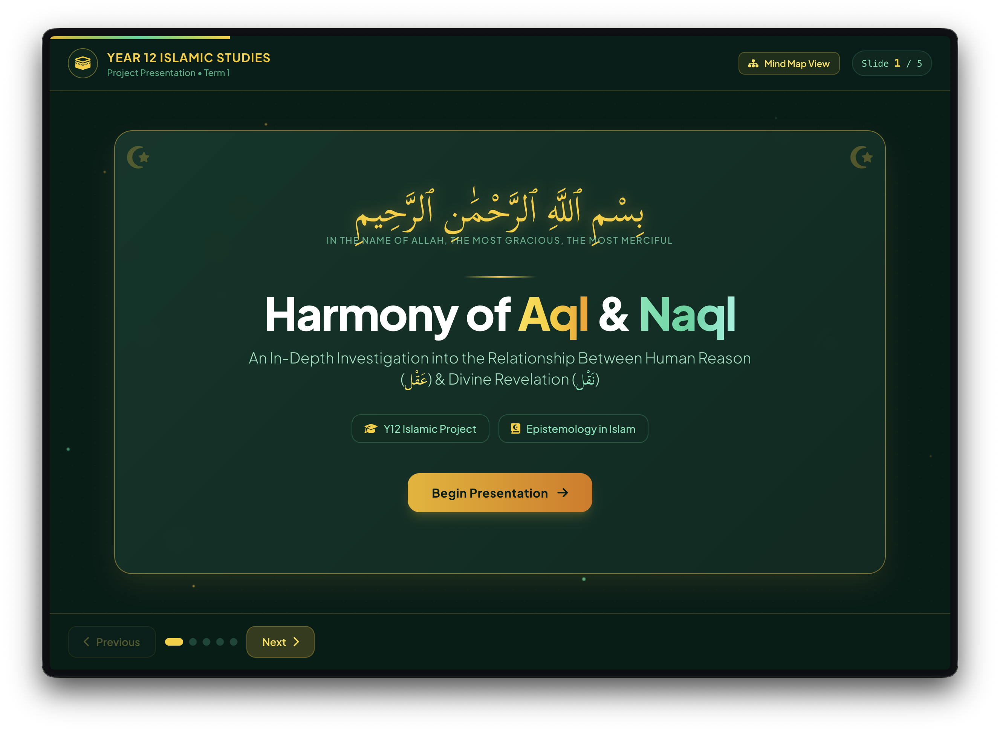
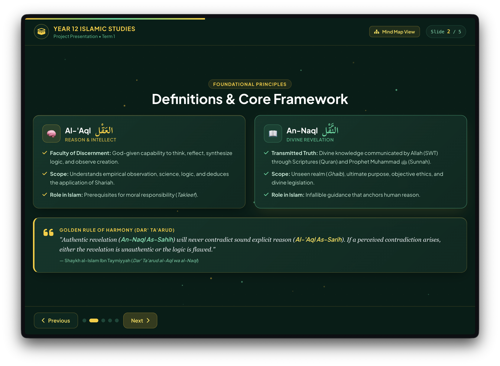
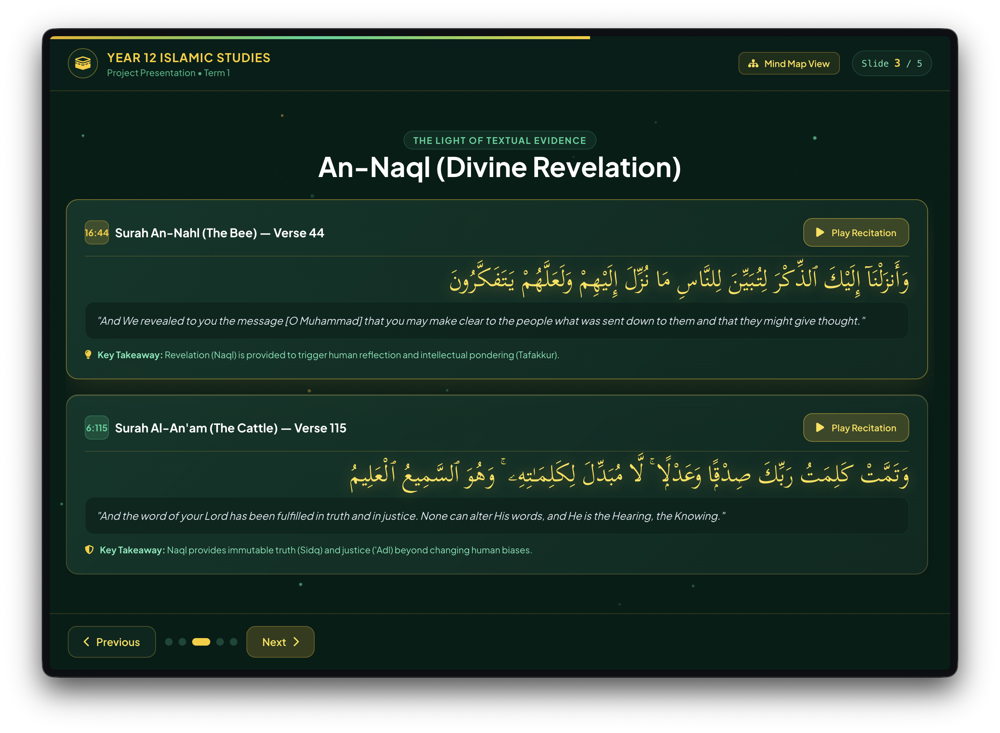
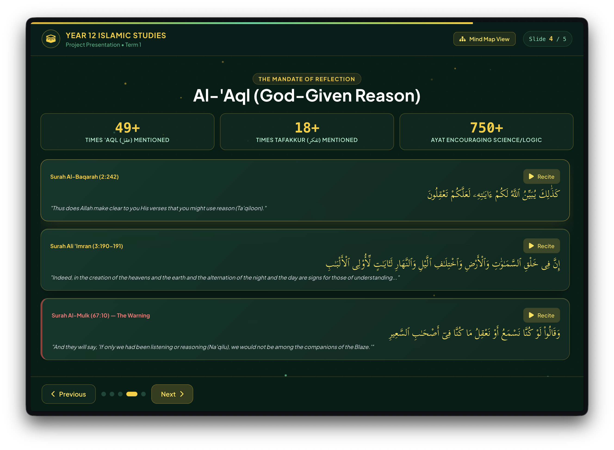
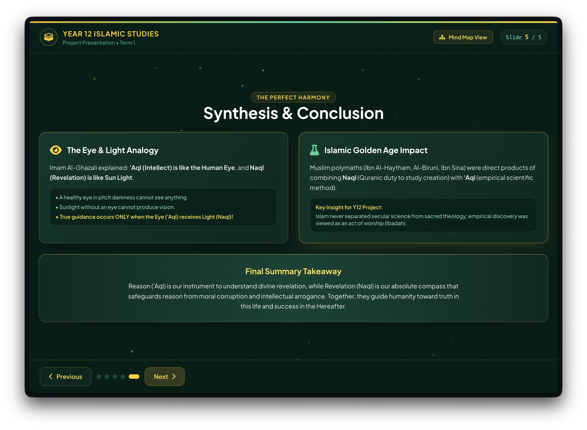

<div align="center">

  # 🕌 Harmony of Aql & Naql
  ### Year 12 Islamic Studies Epistemology Presentation

  [](LICENSE)
  [](https://developer.mozilla.org/en-US/docs/Web/HTML)
  [](https://tailwindcss.com/)
  [](https://developer.mozilla.org/en-US/docs/Web/JavaScript)

  An interactive, web-based presentation platform exploring the Islamic philosophical relationship between **Al-'Aql** (*Reason & Intellect*) and **An-Naql** (*Divine Revelation*). Built with modern UI design, audio player controls for Quranic recitations, fluid animations, and interactive learning tools.

  [Live Demo](https://aql-naql.netlify.app/) • [Features](#key-features) • [Project Structure](#project-structure) • [Audio Setup](#audio-configuration)

</div>

---

## 📸 Screenshots & Visual Overview

Here is a visual preview of the key slides and interactive features included in this project.

### Slide 1: Welcome & Bismillah Intro


### Slide 2: Core Definitions & Framework


### Slide 3: An-Naql (Divine Revelation & Ayat)


### Slide 4: Al-'Aql (Reason, Reflection & Statistics)


### Slide 5: Synthesis, Analogy & Conclusion


---

## ✨ Key Features

- 🎨 **Islamic Aesthetic Design**: Styled with deep emerald (`#021e17`) background colors, glowing gold highlights, glassmorphic cards, and delicate background geometric patterns.
- 📜 **Typography & Calligraphy**: Integrates *Scheherazade New* and *Amiri* fonts for clean, high-contrast Quranic Arabic typography.
- 🔊 **Built-in Audio Player Engine**: Supports custom MP3 audio files for every Quranic Ayah with audio wave visualizer animations and fallback synthesized audio feedback.
- 🧠 **Interactive Mind Map View**: Modal overlay providing a concise, high-level summary of the philosophical concepts.
- 📊 **Animated Counters**: Dynamic numerical statistics highlighting Quranic occurrences of reasoning (`عقل`) and contemplation (`تفكر`).
- 📱 **Fully Responsive**: Fluid layout supporting keyboard navigation (Left/Right Arrows, Spacebar), mobile touch swipe gestures, and screen size adaptation.
- 🌌 **Atmospheric Particles**: Canvas-based particle animation rendering dynamic gold and emerald light ambient effects.

---

## 📂 Project Structure

```text
aql-naql-presentation/
├── index.html              # Main web presentation application
├── README.md               # Repository documentation
├── assets/                 # Screenshot previews & graphical assets
│   ├── slide1-preview.svg
│   ├── slide2-preview.svg
│   ├── slide3-preview.svg
│   ├── slide4-preview.svg
│   └── slide5-preview.svg
└── audio/                  # Quranic recitation MP3 audio files
    ├── audio1.mp3          # Surah An-Nahl (16:44)
    ├── audio2.mp3          # Surah Al-An'am (6:115)
    ├── audio3.mp3          # Surah Al-Baqarah (2:242)
    ├── audio4.mp3          # Surah Ali 'Imran (3:190-191)
    └── audio5.mp3          # Surah Al-Mulk (67:10)
```

---

## 🎵 Audio Configuration

The audio playback engine expects 5 MP3 audio files inside the `audio/` directory:

| Element ID | Ayah Reference | Expected Audio Path |
| :--- | :--- | :--- |
| `audio-ayah-1` | Surah An-Nahl (16:44) | `audio/audio1.mp3` |
| `audio-ayah-2` | Surah Al-An'am (6:115) | `audio/audio2.mp3` |
| `audio-ayah-3` | Surah Al-Baqarah (2:242) | `audio/audio3.mp3` |
| `audio-ayah-4` | Surah Ali 'Imran (3:190-191) | `audio/audio4.mp3` |
| `audio-ayah-5` | Surah Al-Mulk (67:10) | `audio/audio5.mp3` |

> **Note**: If an MP3 audio file is missing or unreadable, the application automatically uses the Web Audio API to play a harmonic fallback chime tone.

---

## 🚀 Getting Started

1. **Clone the repository:**
   ```bash
   git clone https://github.com/rayancheema/aql-naql-presentation.git
   cd aql-naql-presentation
   ```

2. **Add audio files (Optional):**
   Place your 5 `.mp3` recitation files inside the `audio/` folder named `audio1.mp3` through `audio5.mp3`.

3. **Run the presentation:**
   Open `index.html` directly in any web browser (Chrome, Edge, Firefox, Safari). No build tools or Node.js server required!

---

## ⌨️ Keyboard Shortcuts & Controls

- **Next Slide**: Right Arrow `→` or `Spacebar`
- **Previous Slide**: Left Arrow `←`
- **Close Modals**: `Escape`
- **Mobile Navigation**: Swipe left or right across the screen

---

## 🎓 Academic Topics Covered

1. **Definitions**:
   - **Al-'Aql**: Reason, intellectual reflection, empirical logic, human faculty of understanding.
   - **An-Naql**: Divine revelation (Quran & Sunnah), infallible transmitted truth, objective moral framework.
2. **Harmonization Paradigm**:
   - **Ibn Taymiyyah's Rule**: *Dar' Ta'arud al-Aql wa al-Naql* (Sound reason never conflicts with authentic revelation).
   - **Imam Al-Ghazali's Analogy**: Intellect as the *Eye* and Revelation as the *Sunlight*.
3. **Historical Context**:
   - Islamic Golden Age contributions by polymaths (Ibn Al-Haytham, Al-Biruni, Ibn Sina).

---

## 📄 License

This project is open-source and available under the [MIT License](LICENSE).
